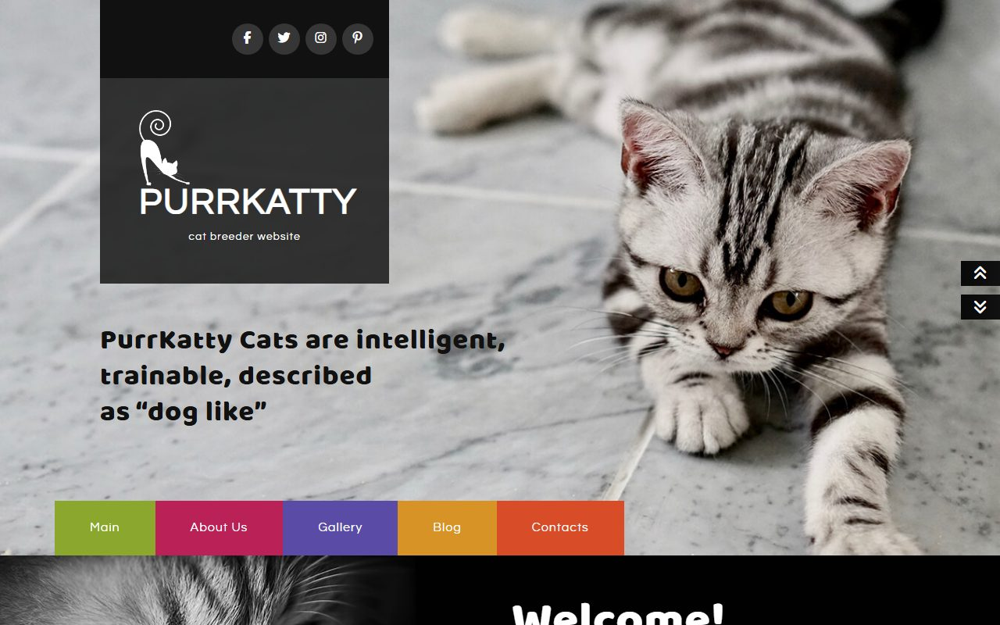

# PurrKatty: free pet website template for a cattery or cat grooming business (HTML5, Bootstrap 5)

A website template for a small cattery, cat breeder or cat grooming salon, by
[ThemeVault](https://www.themevault.net/?utm_source=github&utm_medium=referral&utm_campaign=purrkatty).

**[Live demo](https://demo.themevault.net/purrkatty/)** ·
**[Template page](https://www.themevault.net/purrkatty-free-pet-website-templates?utm_source=github&utm_medium=referral&utm_campaign=purrkatty)**

## What's in it

- **Twelve pages:** home, about, services, booking, gallery, blog, a blog post, shop, a product page, contact and a
  404 page, plus a booking confirmation email.
- **Services with prices:** six grooming and boarding services, each with its price, how long it takes and a
  "Book This" button, and three packages on the home page that list what they include.
- **A booking form that checks itself:** name, phone, email, the cat's name, the service or package, a preferred date
  and the best time to call back. Required fields are flagged, and a filled form shows a thank-you message.
- **A small shop:** eight products, each with its own photo, a filter (All, Food, Grooming, Accessories, Toys) and a
  product page with ingredients and feeding notes.
- **A matching HTML email:** a booking confirmation with the service, cat, date, time, groomer and price, built with
  tables and inline styles so it holds up in email programs.
- **Real copy:** a welcome, an about story, services, testimonials and a blog post on keeping a cat's coat glossy,
  written for a small family cattery, so you can see where your own text goes.
- **Bootstrap 5.3 with no jQuery:** one small `js/main.js` for the menu, the lightbox gallery, form checks, the shop
  filter and back-to-top. Fonts (Questrial and Baloo Thambi) and Font Awesome 6 are included locally.

## Use it

1. Download or clone this repository.
2. Replace the sample text, services, prices and products with your own. The photos in this package are blurred
   placeholders: use your own photos (`IMAGE-CREDITS.txt` lists the sources of the shop photos).
3. Upload the folder to any web host. It's plain HTML, CSS and JavaScript, with no build step.

**Taking real bookings:** the forms check what people type and thank them on screen, but nothing reaches you until
you point them at a form service or your own server. There is no online payment in the shop. If you sell kittens,
check your local rules first (in England, selling animals as pets as a business needs a licence).

## Licence

**Free for personal and commercial use**, for your own or your clients' websites, as long as the "Template by
ThemeVault" credit link in the footer stays in place. You can remove the credit for this template with a one-time
credit removal on the
[template page](https://www.themevault.net/purrkatty-free-pet-website-templates?utm_source=github&utm_medium=referral&utm_campaign=purrkatty),
or on every template with Pro.

This is **not an open-source licence**: you may not resell or redistribute the template, modified or not, as a
template or in a template collection. Full terms: [License.txt](License.txt) and
[themevault.net/license](https://www.themevault.net/license).

More free templates: [themevault.net](https://www.themevault.net/?utm_source=github&utm_medium=referral&utm_campaign=purrkatty)
